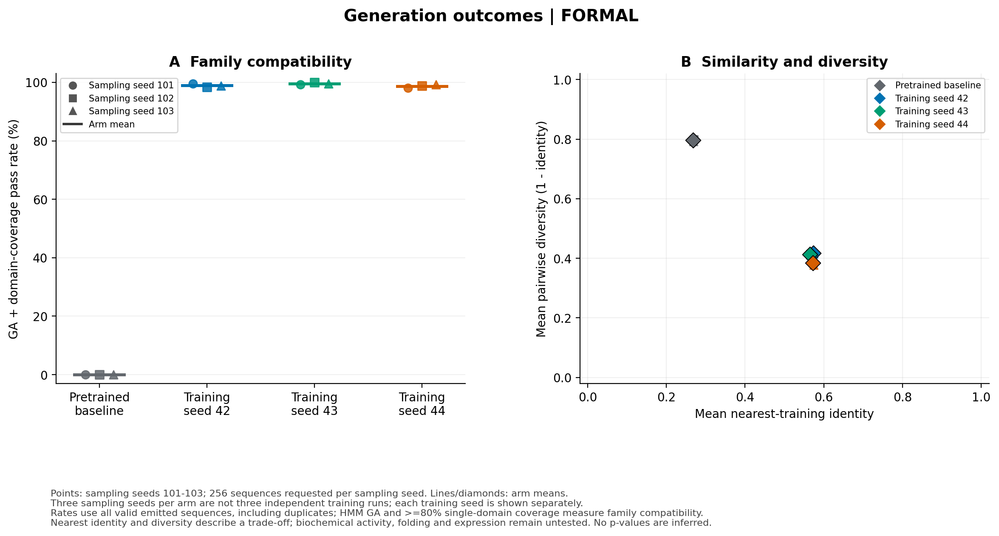

# DPLM Family Lab：从读懂蛋白序列到真实生成式微调

这是一个面向生物 AI 开发工程学习的项目：使用 **DPLM-1 150M**，在 **PF00194（α 型碳酸酐酶）家族序列**上继续训练，比较原始模型和适配后模型生成序列的家族特征、多样性与近邻相似性。这里训练的是蛋白序列生成模型，不是活性回归模型。

项目仓库：[babylovestudy/dplm-family-lab](https://github.com/babylovestudy/dplm-family-lab)。

学习预算为 12 周、每周 10–15 小时。已有的生物统计与科学工作流经验将用于数据审计、实验设计和结果解释；Python、张量和梯度从小例子开始练习。12 周是工作安排，不是就业或模型效果保证。

## 当前状态

真实DPLM-1 150M已在NVIDIA L4上完成**3个训练种子各1000步**，从启动到三次导出结束的总wall time为**32.66分钟**。以下为固定噪声的最佳验证去噪loss及PyTorch峰值已分配显存，原始值见[正式训练证据](results/engineering/formal_training_summary.json)。

| 训练种子 | 优化步 | 最佳验证去噪loss | 峰值已分配显存 |
| --- | --- | --- | --- |
| 42 | 1000 | 0.617952 | 2.85 GiB |
| 43 | 1000 | 0.619555 | 5.64 GiB |
| 44 | 1000 | 0.620384 | 5.65 GiB |

三个模型均有编码器梯度与权重更新证据，导出后CPU重载logits最大误差为0。独立的[真实150M恢复验证](results/engineering/real_150m_resume.json)比较连续10步与第5步停止后恢复至第10步：522个模型张量、1464个优化器张量逐位一致，调度器、采样器与随机状态也一致；该结果限于记录的环境与设置。当前数据拆分为train **2354**、validation **294**、test **294**条，源码身份、权重revision与原始文件SHA已核对。

此前的100步训练pilot记录193.69秒、2.78 GiB，[真实pilot证据](results/pilot/index.json)可直接阅读。[最终Linux L4工程验证](results/engineering/final_validation_summary.json)全量测试为**108 passed、无skip**；既有[CI运行](https://github.com/babylovestudy/dplm-family-lab/actions/runs/38852599537)的两个job均成功。微型网络测试与真实150M运行分别记录，CPU演示使用合成教学数据。

**正式协议已完成：3次训练、12组生成评估和4组固定噪声test去噪齐备，严格汇总为`complete`、缺失阶段为0。** 家族匹配提高，同时最近训练相似性增加、生成集多样性下降；尚未验证结构或酶活。先读[完整技术报告](results/technical-report.md)和[正式结果汇总](results/experiment-summary/report.md)。

同一L4上的20步硬件profiling表明：`micro_batch_size=4`、累积4次时约0.508秒/优化步、2.83 GiB；原始1×16配置约1.8秒/优化步。两者有效序列batch均为16。这是短时实测，不是完整实验耗时保证；仓库默认仍保留较保守的1×16，调整方法见[远程GPU说明](docs/remote-gpu.md)。

## 今天从这里开始

1. 阅读 [第一周任务](docs/week01.md)，先完成环境、FASTA 与张量练习。
2. 运行 [CPU 教学 notebook](notebooks/01_fasta_and_tensors.ipynb)。它不下载模型、不需要 GPU；PyTorch 部分可选。
3. 查看 [12 周路线](docs/learning-roadmap.md)，用每周的验收问题判断自己是否掌握。
4. 准备进入训练时，依次读 [模型原理](docs/model-guide.md)、[远程 GPU](docs/remote-gpu.md) 和 [实验协议](docs/experiment-protocol.md)。

本次实验的 [冻结数据快照](results/dataset-snapshot/README.md) 可离线恢复原始 FASTA/HMM 并重建相同划分；[公开证据校验](scripts/verify_evidence.py) 不需要模型或 GPU。

## 安装与轻量检查

以下命令在项目根目录运行。CPU 学习环境只需 Python 3.10–3.12；远程训练采用单独环境。

先克隆上述仓库并进入目录，再创建环境。系统默认Python若为3.13/3.14，应通过uv选择项目支持的版本；不要直接用不兼容的解释器安装。

```powershell
git clone https://github.com/babylovestudy/dplm-family-lab.git
cd dplm-family-lab
uv venv --python 3.11 .venv
uv pip install --python .venv -e .
.venv\Scripts\python -m dplm_family_lab.cli doctor
.venv\Scripts\python -m dplm_family_lab.cli demo --output-dir artifacts/demo
```

若没有uv，可使用已安装的Python 3.10–3.12运行`python -m venv .venv`，再用`.venv\Scripts\python -m pip install -e .`安装。演示输出目录须为新目录；重复练习时改为如`artifacts/demo-02`，保留旧记录。

激活环境后也可以使用 `dplm-lab doctor`。`doctor` 中 GPU 或外部工具缺失不等于 CPU 学习无法进行；正式家族筛选需要HMMER或`.[hmm]`提供的PyHMMER。聚类/拆分审计使用Biopython严格全局比对、无损剪枝与连通分量，不要求MMseqs2；真实训练使用远程GPU。检查输出应逐项阅读。

未激活Windows环境时，把后文的`dplm-lab`替换成`.venv\Scripts\dplm-lab.exe`即可；Linux远程环境按对应说明激活。notebook的本地启动步骤见[第一周任务](docs/week01.md)。

## 实验入口

正式数据与GPU流程需要联网和相应工具，运行前先看实验协议。`run-experiment`负责训练、配对生成、测试去噪与生成评估；`report`只读取已有结果，不触发训练。

```bash
dplm-lab fetch --config configs/pf00194.yaml
dplm-lab prepare-data --config configs/pf00194.yaml
dplm-lab audit-data --config configs/pf00194.yaml
dplm-lab run-experiment --config configs/pf00194.yaml --pilot
dplm-lab report --config configs/pf00194.yaml --output-dir artifacts/report
```

完整pilot使用一个训练种子、100步训练及baseline/适配模型各32条配对生成，并执行评估，使用独立pilot目录。已通过的100步训练只证明训练阶段，整个pilot是否完成需查看状态记录。

正式协议为3个训练种子各1000步，生成种子101/102/103与baseline及3个适配模型完整交叉：共12组、每组256条，复用长度计划。首次20步检查采用独立smoke配置；正式流程见[实验协议](docs/experiment-protocol.md)。

```bash
dplm-lab run-experiment --config configs/pf00194-l4.yaml
dplm-lab report --config configs/pf00194-l4.yaml --output-dir artifacts/report
```

这里是从新目录开始的公开L4配置（训练4×4、生成batch4）；较保守的canonical配置为`configs/pf00194.yaml`。同一批正式结果的运行、恢复和汇总必须使用对应配置，不把两套配置交叉混用。两套配置都使用`outputs/formal`，若另做实验，应使用独立项目工作目录。

本次远程原始运行实际使用`configs/pf00194-l4-runtime.yaml`，与公开L4配置仅`model.source`不同：它指向已按官方revision和原始SHA核验的`model_cache/dplm_150m`。该机器专用配置与模型缓存不随Git发布；本次恢复和重建报告须用原始runtime配置，不能中途换成公网模型ID。缓存来源、重建方法和读取已公开证据的方法见[远程GPU说明](docs/remote-gpu.md#本次原始运行与公开配置)。

## 正式结果

每组请求256条，12组共3,072条，全部有效、无缺失或非法输出。下表每个arm合并3个生成种子的家族命中计数；最近训练identity与配对距离是三个组均值的简单均值，距离越小表示生成集越相似。

| 模型 | 家族通过/请求 | 家族率 | 平均最近训练identity | 平均配对距离 | 固定噪声test CE |
| --- | ---: | ---: | ---: | ---: | ---: |
| baseline | 0/768 | 0% | 0.268199 | 0.796286 | 0.721707 |
| train seed42 | 760/768 | 98.9583% | 0.573469 | 0.417371 | 0.632358 |
| train seed43 | 765/768 | 99.6094% | 0.564775 | 0.412555 | 0.636451 |
| train seed44 | 758/768 | 98.6979% | 0.572031 | 0.383969 | 0.634815 |

适配模型合计2,283/2,304条通过（99.0885%），2,304条序列均不同；baseline合并后为766/768条不同序列，虽然每组内部都没有重复。双方均未发现完整训练序列复制，因此不能说“复制率降低”或“减少记忆”；片段记忆、其它数据库及预训练重叠仍未知。全部适配序列通过GA，21条因单domain覆盖不足80%未通过家族条件。

这是**家族profile匹配与多样性的权衡**，不能称为功能提升。三个训练种子各含三个生成种子的采样重复，九组适配生成不是九次独立训练；同一HMM参与筛选和评测，validation/test均为80/80图中的singleton，预训练重叠未知。



已有结果可直接阅读，无需重新训练：

1. [技术报告](results/technical-report.md)：完整方法、九项配对差值及区间、成本、负例和解释边界。
2. [严格完整性汇总](results/experiment-summary/summary.json)：`formal_status=complete`、缺失阶段为空；[CSV](results/experiment-summary/summary.csv)同时保留pilot/smoke等其它阶段，按来源与阶段筛选。
3. [配对分析JSON](results/analysis/formal/analysis.json)与[比较CSV](results/analysis/formal/generation_comparison.csv)：训练/生成seed分开，区间为1,000次配对索引bootstrap，不作p值解释。
4. [序列诊断与案例](results/diagnostics/formal/README.md)、[正式原始证据索引](results/formal/index.json)：逐条核对分母、HMM覆盖、最近邻、模型revision与SHA。

三训练含导出wall time为32.66分钟；复用这三份训练后，正式编排阶段wall time为44.05分钟，GPU生成与CPU评估有重叠，不能将各阶段秒数直接相加当作计费时长。实际执行源码快照与发布校验代码的区别见技术报告。

若重跑自己的实验，使用上面的`report`命令；本次原始远程运行使用对应runtime配置。汇总只读取当前机器的`runs/`与`outputs/`，公开bundle用于读取和核对已完成证据，不包含多GB模型检查点。完整恢复的文件及路径限制见[远程说明](docs/remote-gpu.md#取回与复现)。

## 会产出什么

| 产出 | 应有的证据 |
| --- | --- |
| 对蛋白生成模型的理解 | 自己画出的加噪、去噪、训练和采样图；源码阅读笔记 |
| 可复现的开源项目 | 固定数据与版本、命令行工作流、审计报告、测试和失败记录 |
| 真实微调能力 | 编码器参数更新、有限损失与梯度、检查点及恢复训练记录 |
| 科学评估能力 | 基线对照、相同生成预算、HMM 与多样性指标、统计不确定性及边界 |
| 可写进简历的事实 | 可链接的代码、报告和真实测量值，见 [求职证据模板](docs/career-evidence.md) |

## 范围与来源

项目筛选 180–256 aa 的完整序列，以减少首个单卡实验的计算负担；这只是 PF00194 的受限子集。家族筛选和 HMM 命中不证明催化活性，也不保证折叠或实验可用。80% identity / 80% coverage 的聚类划分降低近重复泄漏，不能证明没有更远的同源关系或预训练语料重叠。

官方上游固定为 `bytedance/dplm@8a2e15e53416b4536f03f79ad1f6f6a9cbd5e19d`，权重为 `airkingbd/dplm_150m@49b7125a5d28c6418fcc2f3c4fe799352ac1488b`。源码、权重和数据授权需分别记录；本仓库的许可证不能覆盖外部资产。核查链接与公开范围见 [上游审计](docs/upstream-audit.md)。
