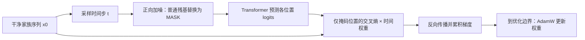
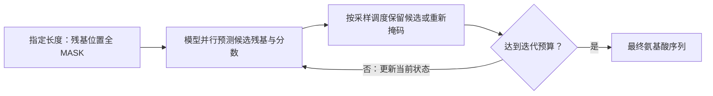

# DPLM-1：本项目实际训练什么

## 从蛋白序列到模型

一条蛋白序列是氨基酸符号序列，tokenizer把符号转成整数，并加入模型所需的起止、填充和掩码token。模型把整数映射到向量，使用Transformer处理上下文，为各位置输出词表上的logits。logits经过softmax才成为概率。

这里选择DPLM-1 150M，只处理序列。DPLM-2的结构token、序列与结构共生成不属于当前实现范围。官方固定版本的[150M配置](https://github.com/bytedance/dplm/blob/8a2e15e53416b4536f03f79ad1f6f6a9cbd5e19d/configs/experiment/dplm/dplm_150m.yaml)提供了模型、任务、损失和优化器设置；本项目不声称复现它的完整预训练规模。

## 离散扩散的直觉

把干净序列记为 `x0`。训练时采样时间步`t`，按对应掩码概率把一部分普通氨基酸替换成MASK，得到`xt`。PAD、BOS、EOS等特殊位置不能随意一起破坏。模型根据未破坏的上下文预测原始氨基酸，损失在目标掩码位置计算，并采用与时间步有关的权重。

官方的`q_sample`、`compute_loss`及`get_non_special_symbol_mask`在[模型源码](https://github.com/bytedance/dplm/blob/8a2e15e53416b4536f03f79ad1f6f6a9cbd5e19d/src/byprot/models/dplm/dplm.py)；交叉熵计算由训练task与criterion衔接。读源码时要追踪实际传入的weighting配置，不能把所有MLM损失都当作同一个目标。

训练时，“加噪”破坏输入，“反向传播”更新参数，二者不是同一个方向的操作：

生成时固定模型参数，反复改进整条序列的候选状态：

两张图均省略BOS/EOS/PAD的展示；这些特殊位置受保护，不作为普通氨基酸破坏或生成。生成图对应本项目无固定motif的DPLM-1序列采样，不沿左到右顺序逐个续写。采样策略、迭代次数、长度、种子和模型版本都会影响生成结果。

本项目在采样时额外屏蔽非标准氨基酸词表项（包括ESM的null token），原始与适配两臂都只允许20种标准氨基酸输出；训练logits不作此限制。它复用官方迭代调度和`gumbel_argmax`策略，但不是完全未修改的官方采样输出。该字母表规则在pilot和正式实验开始前固定，并写入生成manifest的alphabet policy；不是生成后挑选或过滤“好看”的序列。修改位置见[本地来源说明](../src/dplm_family_lab/_vendor/SOURCE.md)。

## 家族定向继续训练

本项目从已训练的`airkingbd/dplm_150m`初始化，用PF00194家族序列继续优化生成式去噪目标。家族信息来自训练数据的分布，**不是给每条序列加一个“α碳酸酐酶”文字提示**，也不需要虚构活性标签。正式训练更新语言模型本体；是否真的更新，要检查可训练参数、梯度和检查点差异，不能只依据命令运行成功。

这个过程也可称“生成式微调”或“家族适配”。它区别于：冻结模型只提取embedding；训练一个活性回归头；只改变采样参数；从随机权重重做UniRef50预训练。对简历和技术报告使用与实际执行一致的名称。

## 为什么要保留原始模型

适配模型可能学到家族偏好，也可能记忆少量训练序列、损失多样性或过拟合。原始模型在相同长度与采样预算下的生成结果是必要基线。验证集用于选择检查点，测试集用于锁定方案后的最终去噪评估；生成序列的HMM分析回答另一类问题，不能互相替代。

固定噪声去噪评估比较同一批序列、同一掩码条件下的预测。它降低评估噪声，但不是精确计算完整序列似然；即使把某个交叉熵取指数，也不能直接称为真实自回归perplexity或生物学质量。

## 读完后请自己回答

- 输入、target、loss mask各是什么shape？PAD为什么不能进入分母？
- 时间步为什么影响破坏程度？训练步数和扩散采样步数为什么不同？
- 没有活性标签，模型到底学习什么？
- HMM命中率提高但最近训练邻居相似性也明显提高时，你会如何解释？
- 什么证据能证明“真实更新过模型”，什么证据才有资格讨论酶活？

学习者应先画流程并作答，再逐段对照源码修订；本文件不提供一套可背诵的面试答案。
